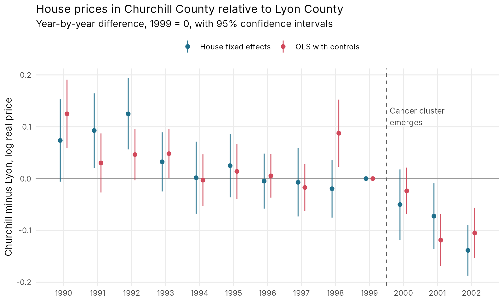

# Replication of Davis (2004): The Effect of Health Risk on Housing Values

An R replication of Lucas W. Davis, "The Effect of Health Risk on Housing Values: Evidence from a Cancer Cluster," *American Economic Review* 94(5): 1693–1704, 2004. [doi:10.1257/0002828043052358](https://doi.org/10.1257/0002828043052358)

All five tables in the paper are reproduced from the raw county assessor records. The estimation sample matches the author's sale by sale (10,204 sales), and **all 51 published numbers checked match to rounding**. An event study is added as an extension.

Prepared for STAT 5200 (Fall 2026).

## The paper in brief

**Question.** How much will households pay to avoid an environmental health risk?

**Setting.** Between 1999 and 2001, Churchill County, Nevada, had a cluster of pediatric leukemia: 16 cases where fewer than two were expected. Nothing about the houses changed, only the perceived risk of living there.

**Data.** Single-family home sales from the county assessors, 1990–2002, for Churchill County and for neighboring Lyon County, which had no cluster and serves as the control.

**Design.** Difference in differences: compare price changes in Churchill with price changes in Lyon, before and after the cluster. The main specification opts for a measure of perceived risk that rises over 2000–2001 rather than a simple "after" dummy. The regressions control for house characteristics, year and month, and in the fixed-effects version compare repeat sales of the same house.

**Finding.** At peak risk, Churchill County houses sold for about 14–16% less than comparable houses. Combined with a Bayesian model of how residents learned about the risk, this implies a value of about $5–6 million per case of pediatric leukemia avoided.

## Results

| | Paper | This replication |
|---|---|---|
| Sample size | 10,204 | 10,204 (every sale matches the author's list) |
| **Table 2.** Simple difference in differences | −0.077 (0.019) | −0.077 (0.019) |
| **Table 3.** Linear spline: OLS / OLS with controls / fixed effects | −0.123 / −0.156 / −0.140 | −0.123 / −0.156 / −0.140 |
| **Table 3.** Cumulative cases: OLS / FE | −0.156 / −0.141 | −0.156 / −0.141 |
| **Table 3.** Newspaper articles: OLS / FE | −0.175 / −0.168 | −0.175 / −0.168 |
| **Table 3.** Bayesian risk: OLS / FE | −0.150 / −0.136 | −0.151 / −0.136 |
| **Table 4.** OLS by house size (four groups) | −0.147, −0.165, −0.153, −0.141 | −0.146, −0.165, −0.153, −0.140 |
| **Table 5.** Value of pediatric leukemia, standard prior ($m): OLS / FE | 5.55 / 5.00 | 5.56 / 5.00 |

Coefficients are changes in log price at peak risk. The full comparison of all 51 numbers is in [`output/tables/comparison_with_paper.csv`](output/tables/comparison_with_paper.csv), and every table is in [`output/tables/`](output/tables/).

## Extension: event study

The paper reports one before-and-after estimate. The figure below estimates the Churchill–Lyon gap separately for each year, with 1999 as the reference year.



- **1994–1999:** the two counties move together, which supports the parallel-trends assumption.
- **After 1999:** the gap opens and widens each year, reaching about −0.10 to −0.14 in 2002. That matches the paper's assumption that perceived risk rose gradually over 2000–2001.
- **1990–1992:** Churchill prices were relatively higher than in 1999, so some of the gap was closing before the cluster. This is a weakness the paper does not discuss.

## How to run

Requirements: R 4.3 or later. All data are included in [`data/raw/`](data/raw/).

```bash
git clone <this-repo-url>
cd davis-2004-replication
Rscript install_packages.R   # haven, dplyr, fixest, ggplot2
Rscript run_all.R            # about 15 seconds
```

`run_all.R` runs five steps in order:

| Script | What it does | Output |
|---|---|---|
| [`R/01_build_data.R`](R/01_build_data.R) | Cleans and merges the four assessor files, builds the risk measures, checks the sample against the author's | `data/derived/analysis_data.rds` |
| [`R/02_tables.R`](R/02_tables.R) | Estimates Tables 1–5 | `output/tables/table1.csv` … `table5.csv` |
| [`R/03_event_study.R`](R/03_event_study.R) | Event-study extension | `output/figures/event_study.png` |
| [`R/04_check_against_paper.R`](R/04_check_against_paper.R) | Compares every result with the published value; fails if any differs | `output/tables/comparison_with_paper.csv` |
| [`R/05_slide_figures.R`](R/05_slide_figures.R) | Presentation figures in a plain black-and-white Times style: the risk measure, the event study and the paper's equations | `output/figures/slides/` |


## Notes on the replication
I ran into some issues when trying to replicate the author's work just via the paper, data, and figures. Upon examining the author's Stata code, I found he made a specific adjustment to the stores sale dates to adjust for a rounding error that shifted odd-numbered days by one.

## Data and license

The data and original code come from the replication package published by the American Economic Association with the article, licensed under [CC BY 4.0](https://creativecommons.org/licenses/by/4.0/) (data) and the Modified BSD License (code); see [`original_code/LICENSE_AEA.txt`](original_code/LICENSE_AEA.txt). The new R code in this repository is released under the [MIT License](LICENSE).

Citation for the original paper:

> Davis, Lucas W. 2004. "The Effect of Health Risk on Housing Values: Evidence from a Cancer Cluster." *American Economic Review* 94 (5): 1693–1704.
